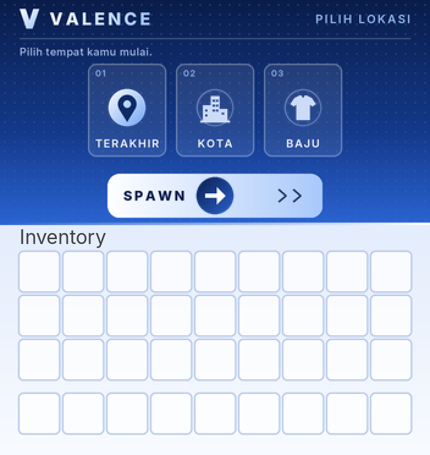

# ValenceIntro

Plugin intro untuk **Valence Roleplay** (Paper 1.21.11). Intro tidak jalan otomatis saat join. Pemain melihatnya setelah mengetik `/intro`.

Alur: layar loading (logo + bossbar) → menu **Pilih Lokasi** → teleport + title sambutan. Tema biru gradasi putih.



*Gambar di atas dirender dari texture, bukan screenshot dari game.*

## Kebutuhan
- Paper 1.21.11, Java 21
- [Oraxen](https://docs.oraxen.com) untuk mengirim resource pack (tidak wajib kalau `custom-ui: false`)

## Pemasangan
1. Unduh jar terbaru di [Releases](../../releases) dan taruh di `plugins/`.
2. Salin folder `oraxen-pack/assets/valence` ke `plugins/Oraxen/pack/assets/valence`.
3. Di Oraxen jalankan `/o reload pack` (atau restart) supaya pack dibangun ulang dan dikirim.
4. Restart server, atur `plugins/ValenceIntro/config.yml` (terutama `spawn` dan `outfit-command`).

Pemain yang menolak pack akan melihat kotak kosong di judul dan ikon yang hilang. Oraxen punya aksi saat pemain menolak pack (`Pack.dispatch.receive.denied`, tipe pesan `KICK`), pakai itu kalau pack harus wajib. Nama persis opsinya bisa berbeda antar versi Oraxen, jadi cek `settings.yml` milikmu.

## Command & permission
| Command | Fungsi | Permission | Default |
|---|---|---|---|
| `/intro` | Jalankan intro untuk diri sendiri | `valenceintro.use` | semua |
| `/intro <player>` | Jalankan intro untuk pemain lain | `valenceintro.others` | op |

## Konfigurasi
Teks memakai [MiniMessage](https://docs.advntr.dev/minimessage/format.html).

| Kunci | Fungsi |
|---|---|
| `custom-ui` | `true` pakai resource pack, `false` pakai teks + item vanilla |
| `loading-seconds` | Lama layar loading |
| `title`, `menu-title` | Karakter gambar dari font `valence:ui` (logo dan panel menu) |
| `title-text`, `menu-title-text` | Versi teks, dipakai kalau `custom-ui: false` |
| `subtitle`, `loading-text`, `welcome-text` | Teks tampilan |
| `outfit-command` | Command (tanpa `/`) yang dijalankan tombol "Ganti Baju" |
| `spawn` | Lokasi "Spawn Kota" |

"Lokasi Terakhir" disimpan otomatis saat pemain keluar dari server.

## Mengubah tampilan
Semua texture dibuat oleh skrip, jadi warna dan tata letak mudah diubah:

```
pip install pillow numpy
python tools/generate_textures.py
```

Ubah `PAL` (warna) atau `build_panel()` (tata letak) di `tools/generate_textures.py`, jalankan ulang, lalu salin hasilnya ke Oraxen. Skrip memakai font Inter (SIL OFL); kalau path font-nya beda, set `VALENCE_FONT_DIR`.

Cara kerjanya, singkat:
- `font/ui.json` mendefinisikan font `valence:ui`: spasi negatif, panel menu (satu karakter besar yang menutupi jendela menu), dan logo.
- Menu memakai chest 4 baris. Posisi slot (11, 13, 15, 31) harus sama dengan gambar panel. Kalau mengubah tata letak, ubah juga konstanta slot di `ValenceIntro.java`.
- Ikon tombol adalah item `PAPER` dengan `item_model` `valence:icon_*`. Versi `_on` dipakai untuk pilihan yang aktif.
- Kalau panel tampak bergeser 1 px ke atas atau bawah di game, ubah `ascent` panel di `font/ui.json` (nilai awal 13).

## Build sendiri
```
mvn package
```
Hasilnya ada di `target/ValenceIntro-<versi>.jar`.

## Rilis (GitHub Actions)
Buat tag berawalan `v`, workflow membangun jar dan membuat Release otomatis:
```
git tag v1.1.0
git push origin v1.1.0
```
Workflow `Build` juga jalan di setiap push dan pull request.

## Lisensi
MIT, lihat [LICENSE](LICENSE). Texture dibuat oleh skrip di repo ini; font Inter berlisensi SIL OFL.
